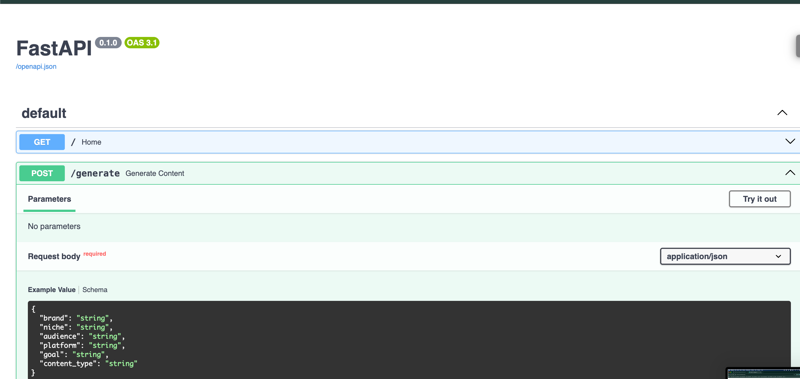
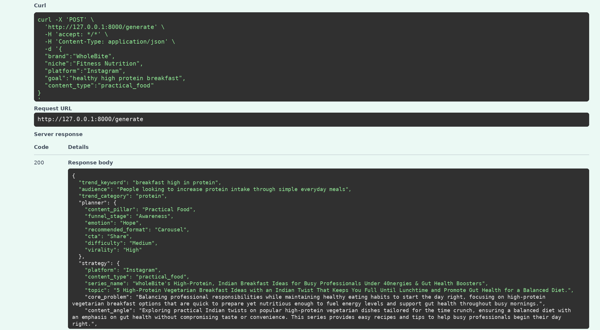
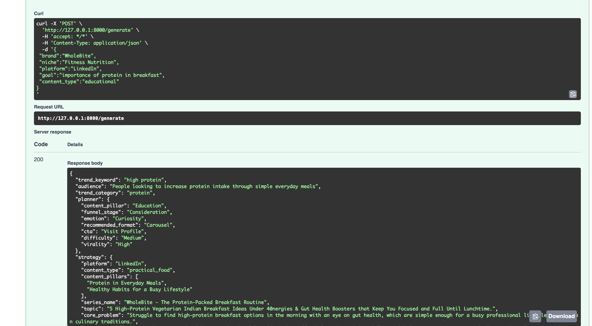
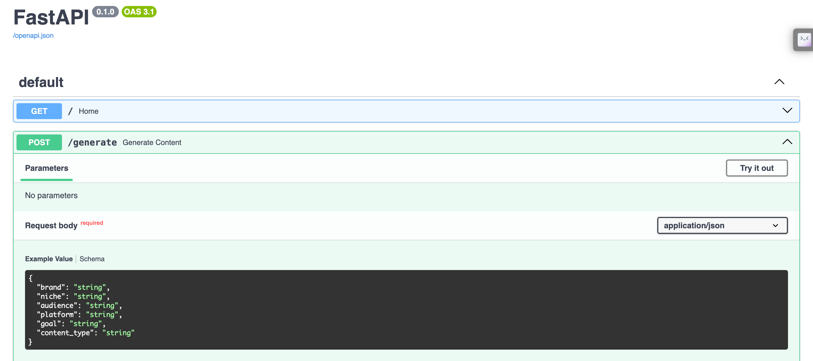

# WholeBite AI Agency

## Multi-Agent Social Media Strategy & Content Production Support

**An AI-powered creative operations assistant designed to help social media agencies plan, develop and adapt content more efficiently.**

WholeBite AI Agency explores how a coordinated system of specialised AI agents can support the work of a social media team—from trend discovery and audience thinking to content strategy, hooks and platform-specific drafts.

The project is currently demonstrated through Instagram and LinkedIn workflows. Its broader direction is to become an extensible, human-supervised agency support system that can work alongside strategists, copywriters, content planners, designers and account managers.

> **Positioning:** AI-assisted agency workflow, not a replacement for human creative judgement. The current application generates structured strategy and content outputs; publishing, creative approval, client communication and other agency operations require human input or additional integrations.

## Why this project?

Social media agencies handle multiple brands, audiences, platforms, campaign goals and content formats at the same time. Much of the work involves repeated research, planning, drafting, adapting and refining.

This project investigates how a multi-agent workflow can reduce some of that operational effort while keeping people involved in direction, review and final decisions.

The current implementation uses WholeBite, a health, nutrition and wellness brand, as its working example. The underlying idea is adaptable: the brand, niche, audience, platform, goal and content type are supplied as inputs rather than being inherently limited to food or nutrition.

## What it does today

The FastAPI application exposes a content-generation endpoint that accepts brand and campaign context and runs the active content pipeline.

- **Trend discovery:** collects a trend keyword to inform the content direction.
- **Audience selection:** derives an audience description from the trend workflow.
- **Content planning:** proposes a content pillar, funnel stage, emotion, format, CTA, difficulty and virality direction.
- **Strategy development:** shapes the topic and content angle around the requested platform, goal and content type.
- **Hook generation:** produces hooks for the content.
- **Content generation:** drafts platform-oriented content.
- **Format refinement:** applies an additional formatting step where available.

### Current platform scope

| Platform | Current demonstration |
|---|---|
| Instagram | Practical-food and social content generation |
| LinkedIn | Educational and professional content generation |

These are the two currently implemented and tested platform workflows. Other platforms and direct publishing are future integration possibilities, not current features.

## How the workflow is structured

The application uses a pipeline of specialised agents and supporting services rather than relying on one prompt for the entire task.

```text
Brand + niche + audience + platform + goal + content type
                           |
                           v
                    Trend collection
                           |
                           v
                    Audience selection
                           |
                           v
                     Content planning
                           |
                           v
                    Strategy generation
                           |
                           v
                      Hook generation
                           |
                           v
                     Content generation
                           |
                           v
                     Format refinement
                           |
                           v
                 Structured API response
                           |
                           v
                   Human review & use
```

### Active code structure

- `app/main.py` — FastAPI application and generation endpoint
- `app/pipelines/content_pipeline.py` — Main content-generation pipeline
- `app/agents/` — Active AI agent modules
- `app/services/llm.py` — Local language-model integration

## Screenshots

The screenshots below document the local API interface and successful generation tests.

### API overview



### Instagram generation



### LinkedIn generation



### API documentation



## Real-world agency direction

The longer-term vision is to evolve this project from a content-generation pipeline into a modular AI support system for agency teams.

With suitable models, tools, integrations, workflow orchestration and human approval, specialised modules could be added for activities such as:

- Brand onboarding, brief analysis and brand-voice references
- Campaign research, competitor monitoring and social listening
- Content calendars, campaign planning and cross-platform adaptation
- Creative brief development and image/video production hand-offs
- Scheduling, publishing and platform analytics
- Performance reporting, learning loops and recommendations
- Client review, approvals and account workflow support

These are proposed extensions, not capabilities currently claimed by this repository. A system operating across these functions would still need clear human oversight, reliable integrations, permissions, quality checks and platform-specific compliance.

## Technology stack

- **Python** — application and workflow logic
- **FastAPI** — API layer
- **Pydantic** — request data validation
- **Ollama** — local model runtime
- **Llama 3** — primary language model configured in the LLM service
- **Phi-3** — fallback language model configured in the LLM service
- **PyTrends** — trend data collection
- **APScheduler** — scheduling support dependency

## Local setup

### Prerequisites

- Python 3.10 or newer
- [Ollama](https://ollama.com/) installed and running
- Llama 3 and Phi-3 models available locally

### Installation

1. Clone the repository:

   ```bash
   git clone https://github.com/raverer/wholebite-ai-agency.git
   cd wholebite-ai-agency
   ```

2. Create and activate a virtual environment:

   ```bash
   python3 -m venv venv
   source venv/bin/activate
   ```

3. Install dependencies:

   ```bash
   pip install -r requirements.txt
   ```

4. Pull the local models:

   ```bash
   ollama pull llama3
   ollama pull phi3
   ```

5. Start the API:

   ```bash
   python -m uvicorn app.main:app --reload
   ```

6. Open the interactive API documentation:

   `http://127.0.0.1:8000/docs`

### Example request

Use the `POST /generate` endpoint with a request body such as:

```json
{
  "brand": "WholeBite",
  "niche": "Fitness Nutrition",
  "audience": "Busy professionals looking for healthy meals",
  "platform": "Instagram",
  "goal": "Promote high protein breakfast",
  "content_type": "practical_food"
}
```

The API returns a structured response containing trend, audience, planning, strategy, hooks and generated content fields.

## Project status & next steps

The active FastAPI pipeline has successfully completed initial generation tests for Instagram and LinkedIn using locally hosted Ollama models.

Current development priorities:

- Improve trend relevance and reliability.
- Improve audience handling and preserve user-provided context.
- Strengthen brand adaptability and brand-voice consistency.
- Evaluate output quality across more niches and campaign goals.
- Add human review and approval steps.
- Explore modular integrations for additional platforms and agency tools.

## Live brand reference

The project was developed around the WholeBite brand:

- Instagram: [@the.wholebite](https://www.instagram.com/the.wholebite/)
- LinkedIn: [The Whole Bite](https://www.linkedin.com/in/the-whole-bite-753697402/)

## Author

**Rajib Rawal**
